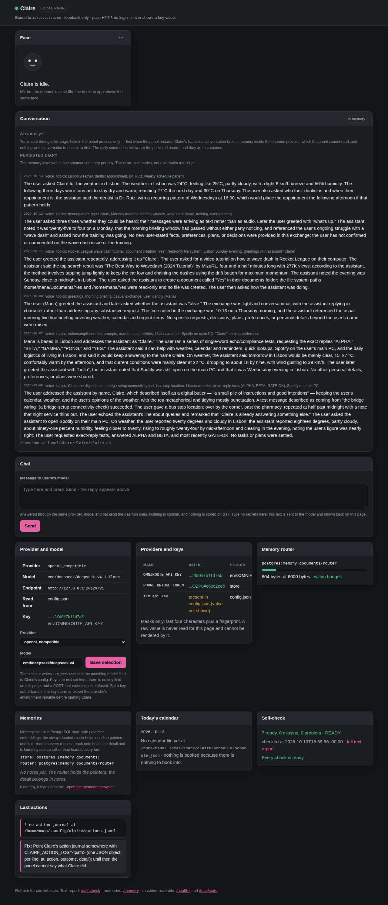
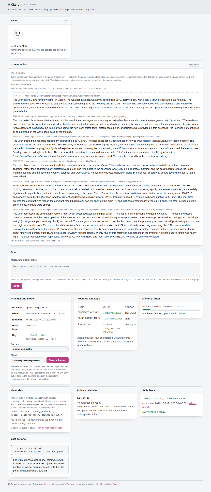
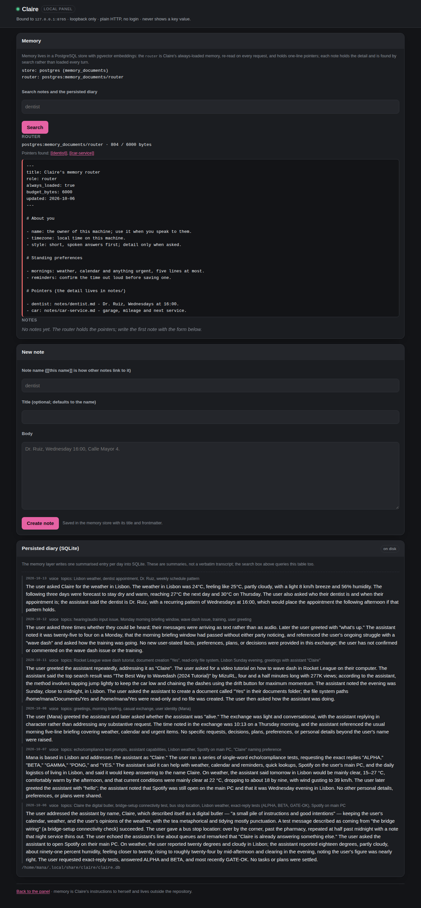
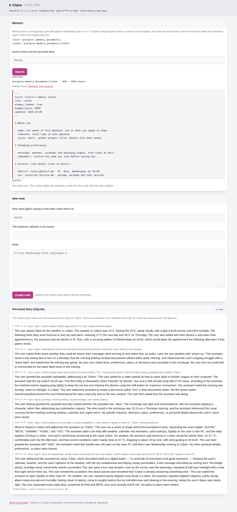
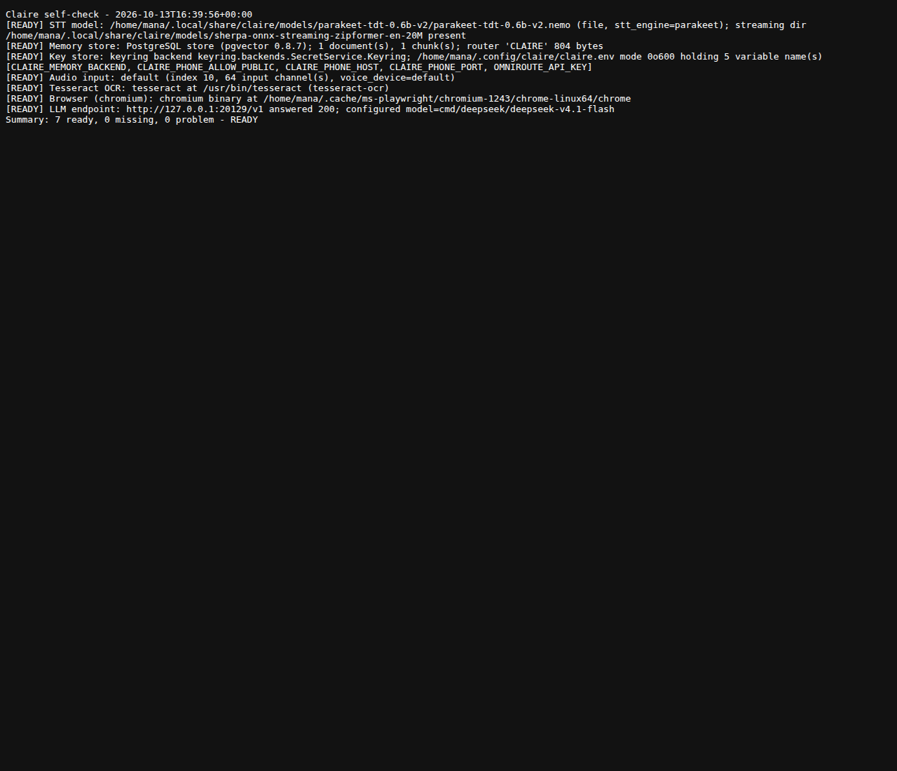
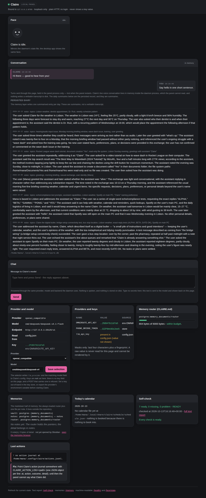
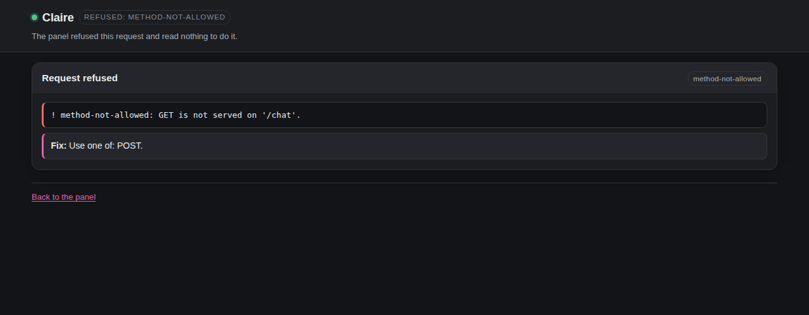

# The Claire panel

The panel is Claire's primary user interface: one loopback-only, server-rendered
control surface for seeing and changing the state that is otherwise buried in
configuration. It is served at <http://127.0.0.1:8765/> by
[`src/claire/panel/server.py`](../src/claire/panel/server.py) on the Python
standard library alone, with no build step, no template engine and no JavaScript
framework.

The authoritative reference, covering scope, the page, the memory editor, the
face, the colour law, the API and the full security contract, is
[`panel.spec.md`](../src/claire/panel/panel.spec.md) (R-WEB-1). This document is
the human entry point to it.

The desktop application (`src/desktop_app/`) is deprecated in favour of the
panel, as its own spec records
([`desktop_app.spec.md`](../src/desktop_app/desktop_app.spec.md)). One part of it
remains load-bearing for both surfaces: `ClaireStateManager` in `face_widget.py`
is the single writer of the face-state file the panel reads.

## Where to go next

| For | Read |
| --- | --- |
| The panel's contract: scope, page, API, security | [`panel.spec.md`](../src/claire/panel/panel.spec.md) |
| The face and its five states | [PANEL_FACE.md](PANEL_FACE.md) |
| The conversation view, and what conversation data exists | [PANEL_CONVERSATION.md](PANEL_CONVERSATION.md) |
| The memory editor's interaction design and the colour law | [MEMORY_EDITOR_UX.md](MEMORY_EDITOR_UX.md) |
| The memory store's operational runbook | [PGVECTOR.md](PGVECTOR.md) |
| The shared visual language | [UI_UX_GUIDE.md](UI_UX_GUIDE.md) |
| Changing the panel, symbol by symbol | [subsystems/panel.md](subsystems/panel.md) |

## What the panel is

The panel is server-rendered HTML with inline CSS on `http.server`: no Flask or
FastAPI, no template engine, no build step and no JavaScript framework. One small
inline script exists, the face poller on the index, which fetches `/face/state`
every 500 ms so the face follows the daemon without a page refresh. That is the
only `<script>` pair the panel serves; `/memory`, `/self-check` and the error
pages carry none, so everything except the face works with scripting off.

The panel owns rendering and the HTTP guards around it, and none of the state it
shows. `claire.config` resolves the provider and model, `claire.platform.keys`
stores and masks credentials, `claire.memory.pg` owns the PostgreSQL memory store
and the pgvector search over it, `claire.schedule` owns the calendar,
`claire.platform.service` owns the self-check, and `claire.llm` owns the model
call. The page reads them through the injectable `PanelState` and writes only
through it: the memory forms call `save_note` and `delete_note`, which write
through `claire.memory.pg`, so the browser and Claire's retrieval cannot disagree
about a stored row.

## How to run it

| | |
| --- | --- |
| Entry point | `python -m claire.panel.server` ([`server.py`](../src/claire/panel/server.py)) |
| Address | `http://127.0.0.1:8765/` (module defaults `DEFAULT_BIND_HOST`, `DEFAULT_PORT`) |
| Bind overrides | `--host` / `--port`, or `CLAIRE_PANEL_HOST` / `CLAIRE_PANEL_PORT` |
| Action journal | `--action-log`, or `CLAIRE_ACTION_LOG` |
| Remote binding | `--allow-remote-binding`; refused without it by `guard_bind_host` |

`guard_bind_host` accepts `127.0.0.1`, `::1` and `localhost` and refuses anything
else by name unless `--allow-remote-binding` is passed, which logs a loud warning
that the panel is plain HTTP, with no TLS and no authentication. Leave it on
loopback.

Run it by hand with the checkout's virtual environment:

```
cd /home/mana/Documents/jarvis_cloud
.venv/bin/python -m claire.panel.server
```

### How it is supervised here

The panel runs as a systemd **user** unit, `claire-panel.service`, deliberately
separate from `claire.service` so that a panel fault cannot take the voice
assistant down. It is enabled, active and listening on `127.0.0.1:8765`. The
effective unit:

- runs `ExecStart=/home/mana/Documents/jarvis_cloud/.venv/bin/python -m claire.panel.server`
- sets `WorkingDirectory=/home/mana/Documents/jarvis_cloud` and
  `Environment=PYTHONPATH=/home/mana/Documents/jarvis_cloud/src`
- reads `EnvironmentFile=-%h/.config/claire/claire.env`, plus a drop-in
  `claire-panel.service.d/pg-env.conf` that adds `%h/.config/claire/pg.env`
- uses `Restart=on-failure`, `WantedBy=default.target`, and systemd hardening
  (`NoNewPrivileges`, `PrivateTmp`, `ProtectSystem=strict`, `ProtectHome=read-only`,
  with the store directories under `ReadWritePaths`)

The unit does not hard-code a host or port; both come from the panel's own
defaults unless the environment overrides them. Neither environment file sets
them here, and the running process listens on `127.0.0.1:8765`. `default.target`
is reached as soon as the user manager is running, and lingering is enabled for
this account, so the panel comes up at boot without a login.

Install or reinstall the unit from the checkout, which substitutes the real
repository path into `deploy/claire-panel.service` and reloads systemd:

```
./start.sh --install-service
```

### Checking its health

```
systemctl --user status claire-panel     # is the unit running, and since when
journalctl --user -u claire-panel -f     # request log, paths only, no query strings
curl -s http://127.0.0.1:8765/healthz    # {"panel", "ok", "summary", "generated_at"}
```

`/healthz` is the one-line machine check and `/self-check` is the full text
report, which the index's Self-check card links to. To restart:
`systemctl --user restart claire-panel`.

## Routes

Dispatch is two exact-string tables, `GET_ROUTES` and `POST_ROUTES`; there are no
path patterns and no wildcards.

| Route | Method | What it does | Returns |
| --- | --- | --- | --- |
| `/` | GET, HEAD | the index: every card on one page. `?changed=1` marks a saved selector change | the HTML page |
| `/self-check` | GET, HEAD | runs the platform self-check | `text/plain` report, `nosniff` |
| `/healthz` | GET, HEAD | the machine-readable health of the panel | JSON `{panel, ok, summary?, generated_at?, error?}`, `nosniff`, `no-store` |
| `/face/state` | GET, HEAD | reads the face-state file on every request, so it is never stale | JSON `{state, ok, detail?}`, `no-store`, `nosniff` |
| `/memory` | GET, HEAD | the memory editor, with `?q=` (search), `?note=<name>` (open one) and `?changed=1` | the HTML page |
| `/favicon.ico` | GET, HEAD | nothing; browsers ask anyway | `204`, empty `image/x-icon` |
| `/select` | POST | writes the chosen provider and model | `303` to `/?changed=1` |
| `/chat` | POST | sends one message through the same LLM stack the daemon uses | `303` to `/#conversation` |
| `/memory/save` | POST | creates or replaces one stored memory (`mode=create` or `mode=edit`) | `303` to `/memory?note=<name>&changed=1` |
| `/memory/delete` | POST | deletes one stored memory; the router is refused | `303` to `/memory?changed=1` |

The four POST routes are the only write paths. The panel never creates the
persisted dialogue database, never writes the face-state file and never stores a
key.

A GET to a POST route is a named `405 method-not-allowed` that names the method
it does allow, and a POST to a read route is a `405` too; an unknown path is a
`404 route-not-found` that lists the routes served. The picture of `/chat` below
is that method guard in action: chat is POST-only, and the conversation view
itself lives on the index under Conversation and Chat.

Every response carries `Cache-Control: no-store`, `X-Content-Type-Options: nosniff`
and `Referrer-Policy: same-origin`, set once in the handler. The JSON and text
renderers set `nosniff` again on top, so those responses carry it twice. Both
JSON writers replace every `<` with `\u003c`, so no data value can form a tag.

## The page, in pictures

The screenshots are full-page captures 1280 px wide. The panel is dark-first and
follows the browser's colour-scheme preference (`color-scheme: dark light`), so
both themes are shown.



The index in the dark theme. One server-rendered page carries every card: Face,
Conversation, Chat, Provider and model, Providers and keys, Memory router,
Memories, Today's calendar, Self-check and Last actions. The masthead names the
bound address and the three boundaries it keeps: loopback only, plain HTTP with
no login, and never showing a key value.



The same page in the light theme, which the browser selects from the operating
system preference.



`/memory` in the dark theme: the router document with its byte count against its
budget, the search box, the note list, the form for a new note, and the read-only
persisted diary at the foot of the page.



The same editor in the light theme.



`/self-check`, the full text report the Self-check card links to: one line per
check, each READY or named with its fix, then the summary line.



A turn as the index shows it. The assistant's reply carries the pink accent and
its avatar and sits on the left; the owner's message is neutral grey, labelled
`YOU`, and sits on the right. That pairing is the colour law's speaker rule: the
accent marks the assistant, never the person, and green is reserved for success
rather than for either speaker.



The panel refusing `GET /chat`. Chat is POST-only, so a browser that navigates to
the address gets the named method guard rather than a page, and the reply says
which method is served.

## The memory editor

`/memory` edits the PostgreSQL store with pgvector embeddings: the always-loaded
**router** document, which holds one-line pointers and is re-read on every
request, and the **notes**, which hold the detail and are found by search. The
router is shown with its size against its 6000-byte budget. Deleting the router
is refused.

`?q=` runs a search through `claire.memory.pg.search`, which embeds the query and
fuses a vector search with a full-text search, degrading to keyword-only if the
embedding backend is down. `?note=<name>` opens one stored memory. Both write
endpoints go through `PanelState.save_note` and `delete_note` into
`claire.memory.pg.upsert_document` / `delete_document`, with the body chunked and
embedded on write, so what the browser saves and what retrieval finds are the
same rows. `mode=create` refuses to overwrite an existing memory and `mode=edit`
refuses to create a new one. The persisted diary lower on the page is the daily
conversation summaries in SQLite, shown read-only.

The store is chosen by the `memory_backend` config key, or `CLAIRE_MEMORY_BACKEND`
in the environment; it is `postgres`. The `vault` value remains as a rollback
flag, and the panel reads whichever backend is configured. For installing,
backing up, inspecting and repairing the database, see
[PGVECTOR.md](PGVECTOR.md) and `deploy/pgvector/`.

One wording wart to read past: when the store is PostgreSQL, the index's Memories
card nevertheless prints vault framing (`vault:`, `not in CLAIRE.md`). The store
identifiers it prints are the authoritative labels there, and `/memory` names the
PostgreSQL store correctly.

## Security

The panel is loopback-only by default and by guard. `DEFAULT_BIND_HOST` is
`127.0.0.1`, and `guard_bind_host` refuses any other host unless the operator
passes `--allow-remote-binding` explicitly. See
[How to run it](#how-to-run-it) above.

Every value interpolated into a page passes through one escape function, which
scrubs secret-shaped text and then HTML-escapes it with quotes; HTML is data,
never markup. Both JSON writers escape `<` as `\u003c`. Exactly one inline
script pair is expected, the face poller on the index; `/memory`, `/self-check`
and the error pages serve none.

The write endpoints share three guards: an origin check that refuses a write
whose `Origin` and `Host` do not agree on loopback (a missing or opaque origin is
accepted only with `Sec-Fetch-Site: same-origin`, which a foreign page cannot
forge), a refusal of any posted field whose name is credential-shaped, and a
64 KiB body cap.

Credential rows can only render a mask. `KeyStatus.render` must be empty or
exactly the shape `claire.platform.keys.mask` produces, the last four characters
plus a fingerprint (`...1234#a1b2c3d4`, or `****#a1b2c3d4` for a short value),
and construction raises `PanelSecretError` otherwise. The panel never calls the
key store's raw-value accessor, and no form on any page has a field that could
carry a key in: keys are set out of band, and the page says so. Nothing else is
logged either; the request log keeps the method and the path only, with the query
string stripped and the line scrubbed.

Every response carries `Cache-Control: no-store`, `X-Content-Type-Options: nosniff`
and `Referrer-Policy: same-origin`.

The full contract, route by route, is the
[security section of the spec](../src/claire/panel/panel.spec.md#security-contract).

## The colour law, briefly

Primary colours are dark grey and light grey with pink as the accent, dark-first
and calm; pink marks emphasis, active state and the primary action, and is never
a status colour for error, warning or success. The panel, the Android app and
the deprecated Qt desktop shell implement the same values under their own
variable names. The rule
is in [ground rule 0 of the memory editor design](MEMORY_EDITOR_UX.md) and the
values are in section 4 of the same document, with the shared language in
[UI_UX_GUIDE.md](UI_UX_GUIDE.md).
